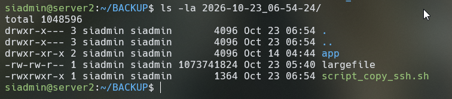
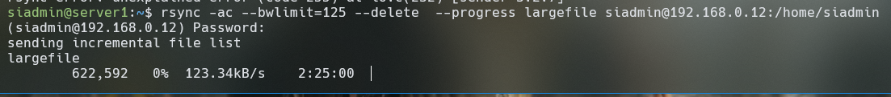
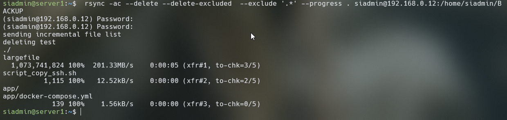
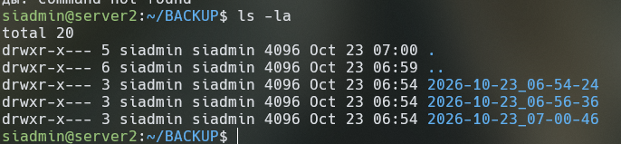
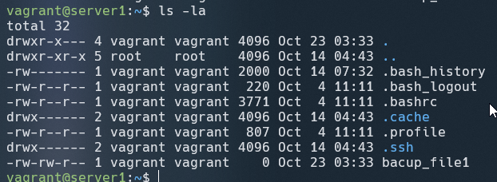
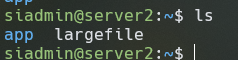
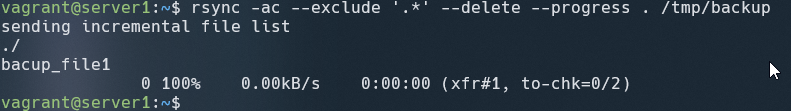
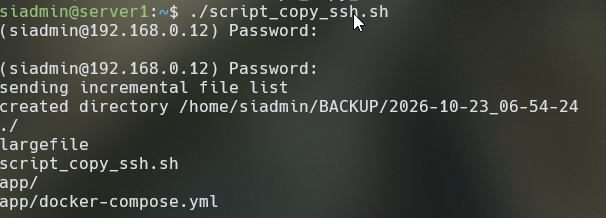
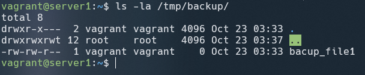

__Задание 1__


* Составьте команду rsync, которая позволяет создавать зеркальную копию домашней директории пользователя в директорию /tmp/backup
* Необходимо исключить из синхронизации все директории, начинающиеся с точки (скрытые)
* Необходимо сделать так, чтобы rsync подсчитывал хэш-суммы для всех файлов, даже если их время модификации и размер идентичны в источнике и приемнике.
* На проверку направить скриншот с командой и результатом ее выполнения

rsync -a --progress . /tmp/backup


rsync -ac --exclude '.*' --delete --progress . /tmp/backup





 rsync -ac --delete --delete-excluded  --exclude '.*' --progress . /tmp/backup

--delete-excluded — удаляет из приемника скрытые файлы и папки (.*), если они успели скопироваться туда во время прошлых запусков.

__Задание 2__


* Написать скрипт и настроить задачу на регулярное резервное копирование домашней директории пользователя с помощью rsync и cron.
* Резервная копия должна быть полностью зеркальной
* Резервная копия должна создаваться раз в день, в системном логе должна появляться запись об успешном или неуспешном выполнении операции
* Резервная копия размещается локально, в директории /tmp/backup
* На проверку направить файл crontab и скриншот с результатом работы утилиты.

Скрипт:


```
#!/bin/bash
SOURCE="$HOME/"
TARGET="/tmp/backup"
mkdir -p "$TARGET"

rsync -ac --exclude ".*" --delete "$SOURCE" "$TARGET" 2> "$HOME/backup_errors.log"

#Проверка выполнения
if [ $? -eq 0 ]; then
    echo "$(date '+%Y-%m-%d %H:%M:%S') - Бэкап успешно завершен" >> "$HOME/backup.log"
else
    echo "$(date '+%Y-%m-%d %H:%M:%S') - Ошибка при выполнении бэкапа! Проверьте backup_errors.log" >> "$HOME/backup.lo>
fi
```





sudo chmod +x [backup.sh](backup.sh)

crontab -e # Каждый день в 5 утра








__Задание 3*__


* Настройте ограничение на используемую пропускную способность rsync до 1 Мбит/c
* Проверьте настройку, синхронизируя большой файл между двумя серверами
* На проверку направьте команду и результат ее выполнения в виде скриншота

Создадим файл для копирования:

fallocate -l 1G largefile

Утилита принимает значение по умолчанию в килобайтах в секунду (КБ/с). Так как 1 Мбит/с равен примерно 125 КБ/с (1000 Кбит / 8), нужно указать значение 125 

rsync -ac --bwlimit=125 --delete –progress largefile siadmin@192.168.0.12:/home/siadmin








__Задание 4*__


* Напишите скрипт, который будет производить инкрементное резервное копирование домашней директории пользователя с помощью rsync на другой сервер
* Скрипт должен удалять старые резервные копии (сохранять только последние 5 штук)
* Напишите скрипт управления резервными копиями, в нем можно выбрать резервную копию и данные восстановятся к состоянию на момент создания данной резервной копии.
* На проверку направьте скрипт и скриншоты, демонстрирующие его работу в различных сценариях.

```rsync -ac --delete --delete-excluded  --exclude '.*' --progress . siadmin@192.168.0.12:/home/siadmin/BACKUP
```





Создадим папки вида 2026-10-23_06-46-17 

находим последнюю:

find . -maxdepth 1 -type d -name '20[0-9][0-9]-*' -printf '%P\n' 2>/dev/null | sort | tail -n 1


```#!/bin/bash

SRC_DIR="$HOME"
REMOTE_USER="siadmin"
REMOTE_HOST="192.168.0.12"
REMOTE_PORT="22"
REMOTE_BACKUP_DIR="/home/siadmin/BACKUP"

# Текущая дата и время для новой папки
DATE_TAG=$(date +%Y-%m-%d_%H-%M-%S)
CURRENT_BACKUP_PATH="${REMOTE_BACKUP_DIR}/${DATE_TAG}"

#echo $CURRENT_BACKUP_PATH

#ssh -p $REMOTE_PORT $REMOTE_USER@$REMOTE_HOST "mkdir -p ${REMOTE_BACKUP_DIR}"

# Поиск последней созданной копии для жестких ссылок (--link-dest)
LATEST_BACKUP=$(ssh -p $REMOTE_PORT $REMOTE_USER@$REMOTE_HOST "find ${REMOTE_BACKUP_DIR} -maxdepth 1 -type d -name '20[0-9][0-9]-*' -printf '%P\n' 2>/dev/null | sort | tail -n 1")
echo $LATEST_BACKUP
LINK_DEST_PARAM=""
#Если найден предыдущий бекап то
if [ -n "$LATEST_BACKUP" ]; then
    LINK_DEST_PARAM="--link-dest=../${LATEST_BACKUP}"
fi
#иначе создается полная копия

# Выполнение rsync
rsync -avz --delete \
    $LINK_DEST_PARAM \
    --exclude '.cache/' \
    --exclude 'Downloads/' \
    --exclude '.virtualenvs/' \
    --exclude ".*" \
    -e "ssh -p $REMOTE_PORT" \
    "$SRC_DIR/" "$REMOTE_USER@$REMOTE_HOST:$CURRENT_BACKUP_PATH"
if [ $? -eq 0 ]; then
        echo "Резервная копия успешно создана в: $CURRENT_BACKUP_PATH"
else
        echo "ERROR BACKUP"
fi
```





*скрипт запрашивает пароль дважды, потому что внутри него выполняются две независимые сетевые команды: сначала проверка наличия прошлых бэкапов через ssh, а затем сама передача файлов через rsync 

Создадим ключ:

Проверка существует ли ls -l ~/.ssh/id_rsa.pub 

ssh-keygen -t rsa -b 4000 

ssh-copy-id -p 22 siadmin@192.168.0.12

Теперь скрипт работает без ввода пароля 




Для удаления старых копий 
```
#!/bin/bash

SRC_DIR="$HOME"
REMOTE_USER="siadmin"
REMOTE_HOST="192.168.0.12"
REMOTE_PORT="22"
REMOTE_BACKUP_DIR="/home/siadmin/BACKUP"
KEEP_BACKUPS=5

# Текущая дата и время для новой папки
DATE_TAG=$(date +%Y-%m-%d_%H-%M-%S)
CURRENT_BACKUP_PATH="${REMOTE_BACKUP_DIR}/${DATE_TAG}"

#echo $CURRENT_BACKUP_PATH

#ssh -p $REMOTE_PORT $REMOTE_USER@$REMOTE_HOST "mkdir -p ${REMOTE_BACKUP_DIR}"

# Поиск последней созданной копии для жестких ссылок (--link-dest)
LATEST_BACKUP=$(ssh -p $REMOTE_PORT $REMOTE_USER@$REMOTE_HOST "find ${REMOTE_BACKUP_DIR} -maxdepth 1 -type d -name '20[0-9][0-9]-*' -printf '%P\n' 2>/dev/null | sort | tail -n 1")
echo $LATEST_BACKUP
LINK_DEST_PARAM=""
#Если найден предыдущий бекап то
if [ -n "$LATEST_BACKUP" ]; then
    LINK_DEST_PARAM="--link-dest=../${LATEST_BACKUP}"
fi
#иначе создается полная копия

# Выполнение rsync
rsync -avz --delete \
    $LINK_DEST_PARAM \
    --exclude '.cache/' \
    --exclude 'Downloads/' \
    --exclude '.virtualenvs/' \
    --exclude ".*" \
    -e "ssh -p $REMOTE_PORT" \
    "$SRC_DIR/" "$REMOTE_USER@$REMOTE_HOST:$CURRENT_BACKUP_PATH"
if [ $? -eq 0 ]; then
        echo "Резервная копия успешно создана в: $CURRENT_BACKUP_PATH"
else
        echo "ERROR BACKUP"
fi
echo "Проверка старых резервных копий..."

# Скрипт ищет все папки бэкапов, сортирует их от старых к новым,
# и удаляет всё, что не попало в последние $KEEP_BACKUPS штук.
ssh -p $REMOTE_PORT $REMOTE_USER@$REMOTE_HOST "export KEEP_BACKUPS=$KEEP_BACKUPS; find ${REMOTE_BACKUP_DIR} -maxdepth 1 -type d -name '20[0-9][0-9]-*' | sort | head -n -\$KEEP_BACKUPS | xargs -I {} rm -rf '{}'"
echo $KEEP_BACKUPS
echo "Очистка завершена. На сервере оставлено последние $KEEP_BACKUPS копий."

```
